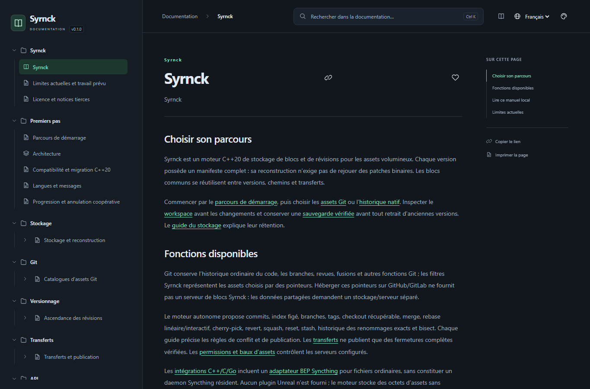

<table width="100%">
  <tr>
    <td width="300" align="left" valign="top">
      <a href="Documentation/Documentation.html#/fr/overview">Manuel local</a><br>
      <a href="https://github.com/MrMybal/Syrnck">Dépôt</a><br>
      <a href="https://github.com/MrMybal/Syrnck/issues">Signaler un problème</a><br><br>
      <sub>README</sub><br>
      <a href="README.md">English</a> · <a href="README.fr.md">Français</a>
    </td>
    <td width="400" align="center" valign="middle">
      <strong>Syrnck</strong><br><sub>C++20</sub>
    </td>
    <td width="300" align="right" valign="top">
      <p><sub>Licence de l’application</sub><br><a href="LICENSE"><strong>MIT</strong></a></p>
      <p><sub>Version</sub><br><a href="VERSION.fr.md"><strong>0.1.0</strong></a><br><strong>PROTOTYPE EXPÉRIMENTAL</strong></p>
    </td>
  </tr>
</table>

<h1 align="center">Syrnck</h1>

Moteur C++20 de stockage et de révisions pour les développeurs de projets aux assets volumineux. Réutiliser les blocs adressés par contenu entre versions de fichiers, garder le code dans Git ou utiliser l’historique autonome sur le même moteur de stockage.

> **PROTOTYPE EXPÉRIMENTAL · 0.1.0**
>
> Ce README décrit les sources actuelles. Aucune release d’application précompilée n’est encore publiée. Consulter les [notes de version et limites documentées](VERSION.fr.md) avant d’adopter les formats.

[](assets/readme/manual-fr.png)

## À propos de Syrnck

Chaque version de fichier possède un manifeste complet : blocs ordonnés, taille et hash du fichier entier. Les versions partagent des blocs sans rejouer une chaîne de patches binaires. Retirer un commit d’une branche ne libère pas automatiquement ses données : branches, tags, index, archives et pins conservent leurs dépendances jusqu’à leur retrait explicite.

Deux parcours utilisent ce moteur. **L’intégration Git** garde l’historique du code, les branches et les merges dans Git, tandis que les assets choisis deviennent des pointeurs Syrnck. **L’historique autonome** propose commits, index, branches, tags et opérations récupérables du workspace. Les dossiers liés partagent un Store avec HEAD/index indépendants, réservation des branches et snapshots portables de sauvegarde. Les assets Git partagés demandent un serveur de blocs Syrnck séparé ; GitHub ne fournit pas automatiquement ce service.

Le moteur s’intègre en C++20. L’ABI C et le binding Go exposent stockage vérifié, plages, plans de réutilisation et observation du workspace. L’adaptateur Go Syncthing optionnel relie les blocs BEP de fichiers ordinaires ; la synchronisation complète de daemons/dossiers reste distincte. Le moteur ne dépend pas du runtime Unreal et traite les assets comme des octets de fichiers ordinaires.

<a id="quick-start"></a>

### Démarrer un projet

Avec le binaire dans PATH, depuis le dossier du projet :

```text
syrnck init
syrnck native commit --message "Premier snapshot du projet"
syrnck native status --combined
syrnck --lang fr help usage
```

Pour un asset existant, `syrnck put Content/Map.uasset` conserve son manifeste et affiche la réutilisation des blocs. `get MANIFESTE NOUVEAU_FICHIER` reconstruit une version sans écraser une destination. Le GC prévisualise ; `gc --delete` retire physiquement les objets inaccessibles. Conserver les racines de rétention et les sauvegardes vérifiées des versions à reconstruire.

## Fonctionnalités

- **Blocs réutilisables** : FastCDC ou découpage fixe, IDs BLAKE3 typés, compression Zstandard, vérification du fichier complet et packs immuables indexés.
- **Versionnage** : filtres/catalogues Git et migration LFS hors ligne ; index natif, HEAD nommé/détaché, différences textuelles, merge, rebase linéaire/interactif, cherry-pick, reset, stash, historique de fichiers, attribution des lignes et bisect, avec leurs limites documentées.
- **Transferts en équipe** : serveur de blocs authentifié, identités/permissions configurées, verrous temporaires d’assets, transfert des objets absents, sessions reprenables et publication de références protégée par jetons de génération.
- **Rétention et récupération** : historique archivé, sauvegardes/restaurations vérifiées, copies réparées et retrait explicite avant collecte.
- **Aide locale** : manuel CyDoc complet anglais/français, recherche, liens de section stables et aide contextuelle du CLI.

---

## Installation

Compiler depuis les sources avec les étapes ci-dessous. Les configurations existent pour Windows et Linux/macOS ; les [notes de version](VERSION.fr.md#plateformes) distinguent les configurations disponibles de la validation des plateformes. Aucune archive d’application précompilée ni aucun installateur n’est actuellement publié.

```text
cmake --install build --config Release --prefix dist
```

Après compilation, cette commande installe le CLI dans `dist/bin`, le dossier `Documentation/` complet à côté, puis les en-têtes, bibliothèques et licences dans leurs répertoires d’installation. Ajouter `dist/bin` au PATH ou appeler le chemin complet de l’exécutable. Le CLI ne demande ni Python ni Node.js à l’exécution ; les fonctions Git demandent Git et l’aide locale un navigateur.

<a id="documentation"></a>

### Manuel local

Utiliser `syrnck help`, `syrnck help native tags` ou `syrnck --lang fr help native-checkout`. Ouvrir aussi [Documentation.html](Documentation/Documentation.html#/fr/overview) depuis un checkout ou une installation locale. Garder le dossier complet : le lecteur fonctionne par file:// sans serveur web, CDN ni connexion Internet. GitHub affiche le source HTML au lieu de l’exécuter.

L’anglais est la langue par défaut ; `--lang` prime sur `SYRNCK_LANG`. Commandes, IDs, JSON et formats réseau restent indépendants de la langue. `syrnck --help` conserve la référence courte du terminal.

<a id="compiler"></a>
<a id="construire-tester-et-installer"></a>

## Sources, compilation et bibliothèques nécessaires

<details>
<summary>Prérequis, récupération des sources et commandes de compilation</summary>

### Prérequis

- CMake 3.25+, Ninja, compilateurs C++20 et C.
- Python 3.9+ pour le script de build et les tests ; Node.js 22+/npm pour générer le manuel.
- Windows : outils C++ de Visual Studio 2022 et SDK Windows. Le script découvre MSVC/CMake/Ninja.
- Builds réseau Linux/macOS : bibliothèques OpenSSL **3.x** de développement. Avec Homebrew, utiliser `ninja` et `openssl@3` ; préciser `-DOPENSSL_ROOT_DIR` si nécessaire.
- Git **2.45+** pour l’intégration Git. Binding Go optionnel : Go 1.22+ ; adaptateur Syncthing optionnel : Go 1.26.2+ et dépendances de modules téléchargées séparément.

### Récupérer les sources

```sh
git clone https://github.com/MrMybal/Syrnck.git
cd Syrnck
```

### Compiler et installer

```text
python scripts/build.py configure
python scripts/build.py build
python scripts/build.py test
cmake --install build --config Release --prefix dist
```

CLI : `build/Release/syrnck.exe` sous Windows et `build/syrnck` avec le preset Unix. Les presets CMake `windows` et `unix` fonctionnent aussi dans un environnement compilateur préparé. La préparation initiale télécharge Zstd/libcurl vérifiés par hash et les dépendances npm figées, sauf si elles sont en cache ; petites dépendances natives et archive CyDoc figée sont incluses.

Pour l’intégration, utiliser `add_subdirectory`, [core.hpp](include/syrnck/core.hpp) ou l’[ABI C](include/syrnck.h). Un build minimal désactive `SYRNCK_BUILD_CLI`, `SYRNCK_BUILD_NETWORK`, `SYRNCK_BUILD_TESTS` et `SYRNCK_BUILD_BENCHMARKS`. La documentation est désactivée par défaut sans CLI ; `SYRNCK_BUILD_DOCUMENTATION=OFF` la désactive explicitement. Les archives C++ statiques demandent leurs dépendances natives au lien final.

Le build ordinaire génère et copie le manuel local. Les commandes de régénération séparée et les instructions d’édition sont dans le [guide de maintenance documentaire](.CyDocBuild/README.md).

</details>

---

<a id="développement-et-licence"></a>

## Licence

Le code original de Syrnck utilise la [licence MIT](LICENSE). Copyright © 2026 MrMybal et contributeurs Syrnck. Les composants tiers conservent leurs conditions propres.

### Composants natifs

| Bibliothèque · sources | Licence · texte | Utilisation / périmètre |
| --- | --- | --- |
| [BLAKE3 C · 1.8.7](https://github.com/BLAKE3-team/BLAKE3) | [Apache-2.0](third_party/blake3/LICENSE_A2) / [CC0](third_party/blake3/LICENSE_CC0) ; [exception LLVM](third_party/blake3/LICENSE_A2LLVM) | Hashes de contenu et IDs d’objets natifs. |
| [FastCDC 2020 · port depuis 5.0.0](https://crates.io/crates/fastcdc/5.0.0) | [MIT](third_party/fastcdc/LICENSE) | Découpage natif dépendant du contenu. |
| [Monocypher · 4.0.2](https://monocypher.org/) | [BSD-2-Clause / CC0](third_party/monocypher/LICENCE.md) | Chiffrement authentifié natif au repos. |
| [nlohmann/json · 3.12.0](https://github.com/nlohmann/json/tree/v3.12.0) | [MIT](third_party/nlohmann/LICENSE.MIT) | Manifestes, révisions et métadonnées natifs. |
| [cpp-httplib · 0.28.0](https://github.com/yhirose/cpp-httplib/tree/v0.28.0) | [MIT](third_party/httplib/LICENSE) | Serveur HTTP ; composant réseau. |
| [utf8proc · 2.10.0](https://github.com/JuliaStrings/utf8proc/tree/v2.10.0) | [MIT et conditions des données Unicode](third_party/utf8proc/LICENSE.md) | Normalisation des chemins et détection des collisions portables. |
| [PicoSHA2](https://github.com/okdshin/PicoSHA2/tree/161cb3fc4170fa7a3eca9e582cebd27cc4d1fe29) | [MIT](third_party/picosha2/LICENSE) | Vérification SHA-256 de l’importeur Git LFS. |
| [Zstandard · 1.5.7](https://github.com/meta/zstd/tree/v1.5.7) | [BSD-3-Clause](https://github.com/meta/zstd/blob/v1.5.7/LICENSE) / [GPL-2.0](https://github.com/meta/zstd/blob/v1.5.7/COPYING) | Compression des objets natifs et des transferts négociés. |
| [libcurl · 8.16.0](https://curl.se/) | [Licence curl](https://github.com/curl/curl/blob/curl-8_16_0/COPYING) | Client HTTP ; Schannel Windows, OpenSSL Unix. |
| [OpenSSL · 3.x](https://github.com/openssl/openssl) | [Apache-2.0](https://github.com/openssl/openssl/blob/openssl-3.0/LICENSE.txt) | Dépendance système des builds réseau Unix. |

### Adaptateur Go optionnel

| Bibliothèque · sources | Licence · texte | Utilisation / périmètre |
| --- | --- | --- |
| [Syncthing · module figé](bindings/syncthing/go.mod) | [MPL-2.0](https://github.com/syncthing/syncthing/blob/v2.1.7/LICENSE) | Adaptateur BEP optionnel pour fichiers ordinaires ; hors du cœur C++. |
| [golang.org/x/text · 0.42.0](https://pkg.go.dev/golang.org/x/text@v0.42.0) | [BSD-3-Clause](https://github.com/golang/text/blob/v0.42.0/LICENSE) | Normalisation Unicode dans l’adaptateur Go optionnel. |

Le binding Go du cœur n’a aucune dépendance de module Go externe. Les autres dépendances directes et transitives de l’adaptateur sont figées dans [go.mod](bindings/syncthing/go.mod) et [go.sum](bindings/syncthing/go.sum), avec leurs notices propres. Elles sont séparées de l’installation CMake du moteur.

### Génération documentaire et lecteur

| Bibliothèque · sources | Licence · texte | Utilisation / périmètre |
| --- | --- | --- |
| [CyDoc · 0.1.0](https://github.com/MrMybal/CyDoc) | [MIT](.CyDocBuild/vendor/CyDoc.LICENSE) | Génération du manuel et lecteur local distribué ; archive figée incluse. |
| [marked · 17.0.6](https://github.com/markedjs/marked) | [MIT](Documentation/DocData/licenses/marked.txt) | Compilation Markdown à la génération. |
| [Prism · 1.30.0](https://github.com/PrismJS/prism) | [MIT](Documentation/DocData/licenses/Prism.txt) | Coloration du code à la génération. |
| [esbuild · 0.25.12](https://github.com/evanw/esbuild) | [MIT](Documentation/DocData/licenses/esbuild.txt) | Outil de build documentaire ; non exécuté par l’aide installée. |

Aucun module média CyDoc optionnel ni aucune dépendance Three.js n’est sélectionné. Les outils de build s’installent séparément. Ces tableaux indexent les principaux composants ; conserver les [notices tierces complètes](THIRD_PARTY.md), le dossier installé `share/licenses/Syrnck` et les textes `DocData/licenses` du lecteur.

## Références et liens

- [Manuel local français](Documentation/Documentation.html#/fr/overview) · [English local manual](Documentation/Documentation.html#/en/overview).
- [Notes de version](VERSION.fr.md) · [Dépôt des sources](https://github.com/MrMybal/Syrnck) · [Suivi des problèmes](https://github.com/MrMybal/Syrnck/issues).
- [Maintenance documentaire](.CyDocBuild/README.md) · [Notices des dépendances](THIRD_PARTY.md).
- Références de conception : [Lore](https://github.com/EpicGames/lore) et [Syncthing](https://github.com/syncthing/syncthing). Les formats et le protocole natifs de Syrnck restent distincts ; l’intégration BEP appartient à l’adaptateur optionnel explicite.
