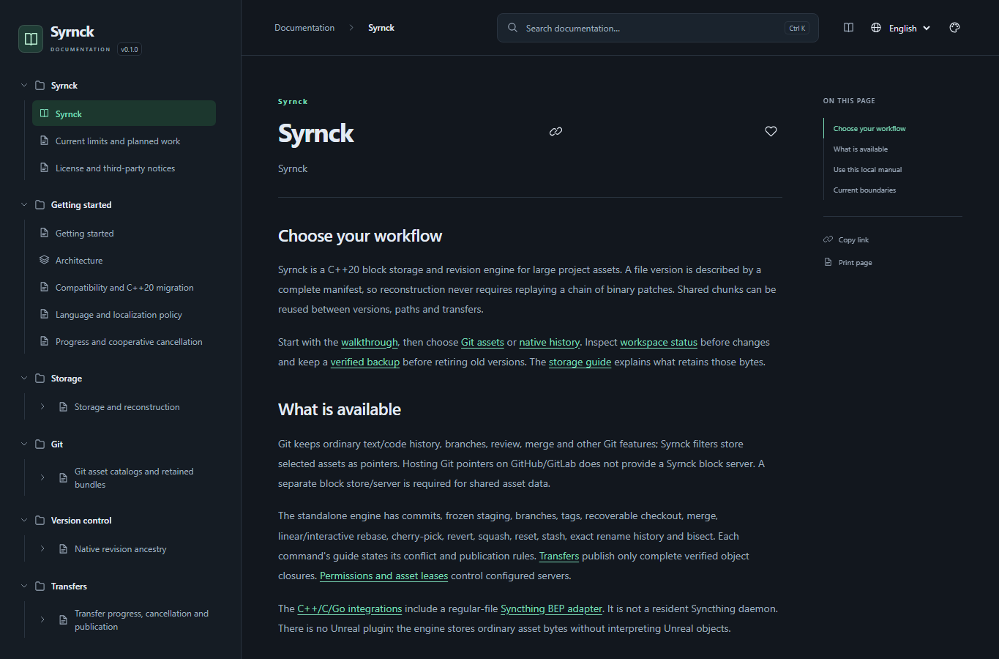

<table width="100%">
  <tr>
    <td width="300" align="left" valign="top">
      <a href="Documentation/Documentation.html#/en/overview">Local manual</a><br>
      <a href="https://github.com/MrMybal/Syrnck">Repository</a><br>
      <a href="https://github.com/MrMybal/Syrnck/issues">Report an issue</a><br><br>
      <sub>README</sub><br>
      <a href="README.md">English</a> · <a href="README.fr.md">Français</a>
    </td>
    <td width="400" align="center" valign="middle">
      <strong>Syrnck</strong><br><sub>C++20</sub>
    </td>
    <td width="300" align="right" valign="top">
      <p><sub>Application license</sub><br><a href="LICENSE"><strong>MIT</strong></a></p>
      <p><sub>Version</sub><br><a href="VERSION.md"><strong>0.1.0</strong></a><br><strong>EXPERIMENTAL PROTOTYPE</strong></p>
    </td>
  </tr>
</table>

<h1 align="center">Syrnck</h1>

A C++20 storage and revision engine for developers working with large project assets. Reuse content-addressed blocks across file versions, keep source code in Git, or use the standalone history over the same storage engine.

> **EXPERIMENTAL PROTOTYPE · 0.1.0**
>
> This README describes the current source checkout. No prebuilt application release is published yet. Read the [version notes and documented limitations](VERSION.md) before adopting the formats.

[](assets/readme/manual-en.png)

## About Syrnck

Each file version has a complete manifest: its ordered blocks, size and whole-file hash. Versions can share blocks without replaying a chain of binary patches. Removing a commit from a branch does not automatically release its data: branches, tags, indexes, archives and pins retain their dependencies until explicitly retired.

Two workflows share this engine. **Git integration** keeps ordinary code history, branches and merges in Git while selected assets become Syrnck pointers. **Standalone history** provides native commits, staging, branches, tags and recoverable workspace operations. Complete or partial linked working directories share one Store with independent HEADs/indexes, branch reservations and portable backup snapshots. Partial views retain complete logical revisions and asset blocks. Optional native identity profiles record original authors and current committers, with Ed25519 commit signatures. Git asset hosting needs a separate Syrnck block server; GitHub does not supply that service automatically.

The resident `syrnck agent run` watches selected local files, captures native snapshots and retries guarded publication after offline edits. It preserves partial workspace content. `--bidirectional` applies clean incoming revisions and merges compatible concurrent histories; `--conflict-copies` optionally retains concurrent asset versions as deterministic tracked siblings. Unresolved namespace conflicts and previously observed remote deletions/rewinds are blocked. Its guarded transactions can resume offline without re-signing prepared targets. A complete unattended folder service remains unfinished.

Embed the engine through C++20. The C ABI and Go binding expose verified storage operations, ranges, reuse plans and workspace observation. The optional Go Syncthing adapter exchanges regular-file BEP blocks over pinned TLS device connections, verified against the real upstream daemon; a native-backed catalog retains folder indexes, vectors, tombstones and verified historical data. A continuous controller now applies regular files to native workspaces, with owned recovery and real-daemon reconnection tests. An explicit recovery policy archives regular-file edits made during checkout and preserves conflict copies. Complete folder metadata, concurrent protocol-version reconciliation and standalone service orchestration remain unfinished. The engine has no Unreal runtime dependency and treats assets as ordinary file bytes.

<a id="quick-start"></a>

### Start a project

With the binary on PATH, run from your project directory:

```text
syrnck init
syrnck native commit --message "Initial project snapshot"
syrnck native status --combined
syrnck help usage
```

For an existing asset, `syrnck put Content/Map.uasset` retains its manifest and reports block reuse. `get MANIFEST NEW_FILE` reconstructs a version without overwriting a destination. `gc` previews collection; `gc --delete` physically removes unreachable objects. Keep the retention roots and verified backups for versions you need to reconstruct.

## Features

- **Reusable blocks:** FastCDC or fixed chunking, typed BLAKE3 IDs, Zstandard compression, complete-file verification and indexed immutable packs.
- **Version control:** Git filters/catalogs and offline LFS migration; native staging, named/detached HEAD, text differences, merge, linear/interactive rebase, cherry-pick, reset, stash, file history, line attribution and bisect, within their documented limits.
- **Team transfers:** authenticated block server, configured identities/permissions, expiring asset locks, missing-object transfers, resumable sessions and fenced reference publication.
- **Retention and recovery:** archived history, verified backups/restores, repair copies and explicit retirement before collection.
- **Local help:** a complete English/French CyDoc manual with search, stable section links and contextual CLI help.

---

## Installation

Build from source using the steps below. Source configurations exist for Windows and Linux/macOS; the [version notes](VERSION.md#platforms) distinguish available configurations from platform validation. The repository currently has no published application ZIP or installer.

```text
cmake --install build --config Release --prefix dist
```

After building, this installs the CLI in `dist/bin`, the complete `Documentation/` folder beside it, and headers/libraries/license notices in their installation directories. Put `dist/bin` on PATH or use the executable’s full path. The CLI needs no Python or Node.js at runtime; Git features require Git and local help needs a browser.

<a id="languages"></a>

### Local manual

Run `syrnck help`, `syrnck help native tags` or `syrnck --lang fr help native-checkout`. You can also open [Documentation.html](Documentation/Documentation.html#/en/overview) from a local checkout or installation. Keep the whole documentation folder: the reader works through file:// without a web server, CDN or Internet connection. GitHub displays the HTML source rather than executing it.

English is the default; `--lang` overrides `SYRNCK_LANG`. Commands, IDs, JSON and network formats remain language-independent. `syrnck --help` keeps the concise terminal reference.

<a id="build-and-test"></a>
<a id="build-test-and-install"></a>

## Source, build and required libraries

<details>
<summary>Requirements, source checkout and build commands</summary>

### Requirements

- CMake 3.25+, Ninja, a C++20 compiler and a C compiler.
- Python 3.9+ for the build helper and tests; Node.js 22+/npm for manual generation.
- Windows: Visual Studio 2022 C++ tools and a Windows SDK. The helper discovers MSVC/CMake/Ninja.
- Linux/macOS network builds: OpenSSL **3.x** development libraries. On Homebrew use `ninja` and `openssl@3`; pass `-DOPENSSL_ROOT_DIR` if the desired OpenSSL is not found.
- Git **2.45+** for Git integration. Optional Go binding: Go 1.22+; optional Syncthing adapter: Go 1.26.2+ and its separately downloaded module dependencies.

### Get the source

```sh
git clone https://github.com/MrMybal/Syrnck.git
cd Syrnck
```

### Build and install

Optional archive prefetch: `python scripts/fetch_dependencies.py` retries transient
download failures and verifies the SHA-256 pins shared with CMake in
`cmake/dependencies.json`. Verified archives in `.tools/downloads` are reused
without network access; an invalid cached archive is refused. Use `--core-only`
when preparing only the storage library.
If GitHub Releases is unavailable, Zstd has an independently pinned archive of
the same official source tag; each archive keeps its own checksum and cache name.

```text
python scripts/build.py configure
python scripts/build.py build
python scripts/build.py test
cmake --install build --config Release --prefix dist
```

The CLI is `build/Release/syrnck.exe` on Windows and `build/syrnck` with the Unix preset. CMake presets `windows` and `unix` also work in an initialized compiler environment. Initial preparation downloads hash-verified Zstd/libcurl archives and npm’s locked dependencies unless cached; small native dependencies and the pinned CyDoc archive are included.

For embedding, use `add_subdirectory`, [core.hpp](include/syrnck/core.hpp) or the [C ABI](include/syrnck.h). A minimal library build disables `SYRNCK_BUILD_CLI`, `SYRNCK_BUILD_NETWORK`, `SYRNCK_BUILD_TESTS` and `SYRNCK_BUILD_BENCHMARKS`. Documentation defaults off without the CLI; `SYRNCK_BUILD_DOCUMENTATION=OFF` disables it explicitly. Static C++ archives require their native dependencies at final link.

The normal build generates and copies the local manual. Separate regeneration commands and authoring instructions are in the [documentation maintenance guide](.CyDocBuild/README.md).

</details>

---

<a id="development-and-license"></a>

## License

Syrnck’s original code uses the [MIT license](LICENSE). Copyright © 2026 MrMybal and Syrnck contributors. Third-party components retain their own terms.

### Native components

| Library · source | License · terms | Use / scope |
| --- | --- | --- |
| [BLAKE3 C · 1.8.7](https://github.com/BLAKE3-team/BLAKE3) | [Apache-2.0](third_party/blake3/LICENSE_A2) / [CC0](third_party/blake3/LICENSE_CC0); [LLVM exception](third_party/blake3/LICENSE_A2LLVM) | Native content hashes and object IDs. |
| [FastCDC 2020 · port from 5.0.0](https://crates.io/crates/fastcdc/5.0.0) | [MIT](third_party/fastcdc/LICENSE) | Native content-defined chunking. |
| [Monocypher · 4.0.3](https://monocypher.org/) | [BSD-2-Clause / CC0](third_party/monocypher/LICENCE.md) | Native authenticated encryption at rest and Ed25519 commit signatures. |
| [nlohmann/json · 3.12.0](https://github.com/nlohmann/json/tree/v3.12.0) | [MIT](third_party/nlohmann/LICENSE.MIT) | Native manifests, revisions and metadata. |
| [cpp-httplib · 0.28.0](https://github.com/yhirose/cpp-httplib/tree/v0.28.0) | [MIT](third_party/httplib/LICENSE) | HTTP server; network component. |
| [utf8proc · 2.10.0](https://github.com/JuliaStrings/utf8proc/tree/v2.10.0) | [MIT and Unicode data terms](third_party/utf8proc/LICENSE.md) | Portable path normalization and collision checks. |
| [PicoSHA2](https://github.com/okdshin/PicoSHA2/tree/161cb3fc4170fa7a3eca9e582cebd27cc4d1fe29) | [MIT](third_party/picosha2/LICENSE) | SHA-256 verification in the Git LFS importer. |
| [Zstandard · 1.5.7](https://github.com/meta/zstd/tree/v1.5.7) | [BSD-3-Clause](https://github.com/meta/zstd/blob/v1.5.7/LICENSE) / [GPL-2.0](https://github.com/meta/zstd/blob/v1.5.7/COPYING) | Native object and negotiated transfer compression. |
| [libcurl · 8.16.0](https://curl.se/) | [curl license](https://github.com/curl/curl/blob/curl-8_16_0/COPYING) | HTTP client; Schannel on Windows, OpenSSL on Unix. |
| [OpenSSL · 3.x](https://github.com/openssl/openssl) | [Apache-2.0](https://github.com/openssl/openssl/blob/openssl-3.0/LICENSE.txt) | System-provided dependency for Unix network builds. |

### Optional Go adapter

| Library · source | License · terms | Use / scope |
| --- | --- | --- |
| [Syncthing · pinned module](bindings/syncthing/go.mod) | [MPL-2.0](https://github.com/syncthing/syncthing/blob/v2.1.7/LICENSE) | Optional regular-file BEP adapter; outside the C++ core. |
| [golang.org/x/text · 0.42.0](https://pkg.go.dev/golang.org/x/text@v0.42.0) | [BSD-3-Clause](https://github.com/golang/text/blob/v0.42.0/LICENSE) | Unicode normalization in the optional Go adapter. |

The core Go binding has no external Go module dependency. The adapter’s other direct and transitive dependencies are pinned in [go.mod](bindings/syncthing/go.mod) and [go.sum](bindings/syncthing/go.sum), with their own notices. They are separate from the CMake engine installation.

### Documentation generation and reader

| Library · source | License · terms | Use / scope |
| --- | --- | --- |
| [CyDoc · 0.1.0](https://github.com/MrMybal/CyDoc) | [MIT](.CyDocBuild/vendor/CyDoc.LICENSE) | Manual generation and distributed offline reader; pinned archive included. |
| [marked · 17.0.6](https://github.com/markedjs/marked) | [MIT](Documentation/DocData/licenses/marked.txt) | Build-time Markdown compilation. |
| [Prism · 1.30.0](https://github.com/PrismJS/prism) | [MIT](Documentation/DocData/licenses/Prism.txt) | Build-time code highlighting. |
| [esbuild · 0.25.12](https://github.com/evanw/esbuild) | [MIT](Documentation/DocData/licenses/esbuild.txt) | Documentation build tool; does not run inside installed help. |

No optional CyDoc media module or Three.js dependency is selected. Build tools are installed separately. These tables index the main components; retain the complete [third-party notices](THIRD_PARTY.md), the installed `share/licenses/Syrnck` directory and the reader’s `DocData/licenses` files.

## References and links

- [English local manual](Documentation/Documentation.html#/en/overview) · [Manuel local en français](Documentation/Documentation.html#/fr/overview).
- [Version notes](VERSION.md) · [Source repository](https://github.com/MrMybal/Syrnck) · [Issue tracker](https://github.com/MrMybal/Syrnck/issues).
- [Documentation maintenance](.CyDocBuild/README.md) · [Dependency notices](THIRD_PARTY.md).
- Design references: [Lore](https://github.com/EpicGames/lore) and [Syncthing](https://github.com/syncthing/syncthing). Syrnck’s native formats and protocol are distinct; BEP integration belongs to the explicit optional adapter.
