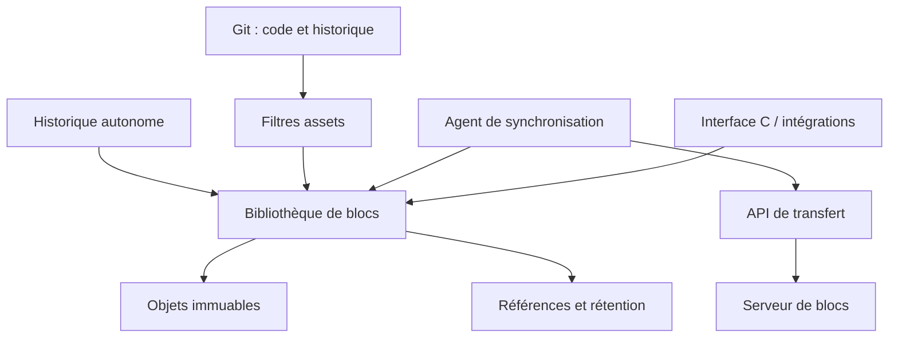

# Architecture de Syrnck

## Objectif et décisions

Un même moteur doit servir les assets lourds, le contrôle de versions autonome et la synchronisation de fichiers. Le code source doit aussi garder ses diff, merge, rebase, blame, tags, hooks et outils de revue. Le mode Git délègue ces fonctions à Git ; le mode autonome devra les offrir progressivement au-dessus des mêmes objets.

C++20 est retenu pour une bibliothèque native portable, une intégration au développement Unreal et une interface C utilisable depuis Go. CMake construit les bibliothèques et exécutables ; RAII, les tests et les sanitizers encadrent la gestion de mémoire. La bibliothèque de stockage ne dépend ni de Git, ni d'HTTP, ni d'un watcher. Le CLI et les adaptateurs dépendent de la bibliothèque, et non l'inverse.



Ce découpage rejoint un principe exposé dans la [conception de Lore](https://epicgames.github.io/lore/explanation/system-design/) : le stockage peut être consommé séparément du contrôle de versions. Il ne crée aucune compatibilité avec les formats Lore.

## Fichiers et révisions

Un bloc est identifié par BLAKE3 avec un domaine séparant les types d'objets. Un manifeste contient la taille du fichier, son hash complet, la politique de découpage et la liste **ordonnée et complète** des blocs. Deux versions peuvent partager un bloc sans partager une relation de parenté.

Une révision autonome contient un arbre logique complet `chemin → manifeste + métadonnées`, ses parents et son message. Le prototype représente l'arbre dans une table triée ; une arborescence Merkle paginée remplacera cette représentation pour les grands dépôts. Chaque révision reste un état complet, même après ce changement de représentation.

Exemple :

```text
Version A : [bloc 1][bloc 2][bloc 3][bloc 4]
Version B : [bloc 1][bloc X][bloc 3][bloc 4]
```

La nouvelle version stocke et transmet le bloc X et son manifeste. Reconstituer B ne demande pas de rejouer A. Si A est supprimée, les blocs 1, 3 et 4 restent vivants tant que B les référence.

Le découpage ne comprend pas les objets Unreal. Une modification de quelques octets peut modifier un bloc entier, parfois plusieurs. Une réécriture, une compression ou un chiffrement préalable d'un asset peut modifier presque tous ses octets et réduire fortement la déduplication.

## Politique de découpage

Le prototype propose FastCDC 2020 avec minimum 256 Kio, moyenne cible 1 Mio et maximum 4 Mio, ainsi que des blocs fixes configurables. FastCDC permet de retrouver des frontières communes après une insertion ou une suppression ; la taille moyenne cible n'est pas une taille garantie. Le choix sera ensuite configurable par type de fichier et mesuré sur corpus.

[Lore documente son choix de FastCDC](https://epicgames.github.io/lore/developing/decisions/00001-fast-cdc/). À l'inverse, le [BEP de Syncthing](https://docs.syncthing.net/specs/bep-v1.html) utilise des blocs de 128 Kio à 16 Mio, de taille constante dans un fichier sauf le dernier. Le mode fixe de Syrnck ne suffit donc pas à rendre ses objets ou son réseau compatibles avec Syncthing : les hashes, métadonnées, messages, identités et règles de version sont aussi différents.

## Mode Git

Les fichiers texte restent des blobs Git ordinaires. Les assets sélectionnés par `.gitattributes` passent par `clean`, qui écrit un pointeur vers un manifeste. `smudge` reconstruit les octets lors du checkout. Les filtres sont déclarés obligatoires : une erreur de stockage ne doit pas faire croire à Git qu'un asset a été correctement reconstruit.

L'adaptateur utilise un format de pointeur Syrnck, distinct de [Git LFS](https://raw.githubusercontent.com/git-lfs/git-lfs/main/docs/spec.md). GitHub et GitLab peuvent héberger l'historique Git contenant ces pointeurs, mais ne fournissent pas automatiquement le service de blocs Syrnck, les aperçus d'assets ou une interface LFS compatible.

Chaque manifeste complet passé dans le filtre est épinglé. Un pointeur canonique non hydraté est conservé sans créer de pin incomplet, pour permettre les clones à pointeurs seuls. Le rapprochement automatique avec branches, tags, reflogs, worktrees et index Git reste à développer. Les [catalogues Git](GIT_ASSETS.md) associent une racine de révision sans parent à chaque commit, avec conservation locale et publication distante immuable. `syrnck_git_net` relie ces catalogues aux transferts réseau et vérifie les pointeurs avant publication locale. Un hook pre-push installé explicitement envoie les catalogues de toute l'ascendance avant la publication Git. Les politiques `local`/`download`/`skip` règlent le checkout : le téléchargement opt-in utilise le manifeste du pointeur, un bail de lecture et les sessions persistantes, sans dépendre de HEAD. Avant reconstruction, smudge vérifie taille, blocs et hash complet. `filter-process` reste à développer ; le hook local n'assure pas une transaction distribuée avec le serveur Git.

## Mode autonome

Le prototype offre la création de révisions, des branches nommées, un journal par premier parent et un export vers un nouveau dossier. Il permet aussi de détacher l'historique en gardant l'état courant et en archivant l'ancienne tête.

L'index de staging, le checkout d'un workspace existant, les merges de texte à trois voies, les conflits, tags, rebase, cherry-pick, stash, blame, bisect, historique des renommages et signatures font partie de la feuille de route. Les parents multiples sont représentables dans le format, mais aucun algorithme de merge autonome n'est implémenté.

Les fichiers source utilisent actuellement le même moteur de stockage en mode autonome. Leur future interface de diff et de merge sera textuelle. L'utilisation de blocs pour les stocker n'oblige pas à présenter des différences de blocs à l'utilisateur.

## Stockage physique et packs

Les objets logiques v1 peuvent être stockés dans des fichiers isolés ou dans des packs immuables indexés. `Store::pack()` et `syrnck pack` ajoutent des packs pour les seuls nouveaux objets ; `pack --compact` regroupe tout le stock. La configuration physique passe à v2 pour un seul pack, puis v3 pour un catalogue de plusieurs packs ; les nouveaux stores restent v1. Le remplacement atomique de `config.json` publie le catalogue complet après écriture et relecture vérifiée, avant tout retrait. Le GC préserve les packs entièrement vivants, retire ceux entièrement morts et réécrit les seuls packs partiellement morts. Les références et les blocs partagés conservent les mêmes règles de rétention.

Les index sont lus par pages de 256 entrées. Un répertoire de bornes/empreintes et un filtre de clés absentes remplacent la table complète ; une LRU de pages de 4 Mio est configurable indépendamment du cache décodé. L'ouverture vérifie encore chaque index complet et les doublons entre packs par parcours fusionnés. Les limites restent 1 048 576 entrées par pack, 1 024 packs et 4 194 304 entrées au total. Le GC et `fsck` parcourent les inventaires en flux, avec un bit de marquage par objet empaqueté ; le GC recopie également les survivants en flux. Les clés parcourues absentes des packs, la pile de parcours et le JSON restent en mémoire ; `objects()` et l'API publique `closure()` gardent encore leurs collections d'identifiants. L'empaquetage et la compaction fusionnent les index par pages et gardent seulement les clés isolées à trier ; voir les [garanties de compaction](COMPACTION.md). Une session réutilise au plus 8 handles de packs avec LRU et les ferme avant publication/suppression. La maintenance conserve le verrou exclusif. L'index ne dispense pas de vérifier les enveloppes réellement lues, et `fsck` contrôle aussi les doublons physiques. Voir les [garanties des audits](AUDIT.md), les [budgets des index](INDEXES.md) et les [étapes de reprise](PACKS.md).

## Pipeline d'ingestion

L'ingestion C++ peut utiliser un pool de 2 à 64 workers pour la compression et le chiffrement des blocs nouveaux. Le coordinateur conserve le découpage CDC, les hashes, la détection des doublons, l'ordre du manifeste et les écritures atomiques. Les workers ne modifient ni le store ni les références ; chacun possède son contexte Zstd réutilisable. Un budget d'octets et un plafond de `2 × workers` tâches imposent l'attente du producteur quand la file est pleine. Le mode séquentiel reste le choix par défaut.

Les buffers bruts sont libérés avant que le résultat d'encodage soit livré au coordinateur. À ce budget s'ajoutent les buffers compressés/chiffrés, le tampon de lecture, les contextes Zstd par worker et les métadonnées. Le manifeste plat est borné pendant la lecture par sa limite sérialisée de 16 Mio ; cette limite ne représente pas sa consommation en mémoire sous forme JSON.

La publication des blocs suit leur première apparition dans le fichier. Le manifeste n'est créé qu'après la réussite de toutes les tâches. Les exceptions des workers remontent au coordinateur ; lecture en échec, écriture refusée et annulation coopérative arrêtent les tâches restantes et joignent les threads. Les références existantes restent intactes. Des blocs orphelins déjà publiés peuvent subsister jusqu'à leur réutilisation ou leur collecte. Le verrou exclusif externe du store reste nécessaire ; le parallélisme interne ne rend pas le handle utilisable simultanément par plusieurs appelants.

## Cache et parcours de validation

Le cache est local au handle et ne constitue pas une source d'autorité sur disque. Une entrée n'est créée qu'après validation complète d'un objet lu : déchiffrement/authentification si nécessaire, décompression bornée, ID et format. Elle associe la clé typée à l'empreinte BLAKE3 de l'enveloppe exacte. Les accès suivants relisent et hachent cette enveloppe avant de réutiliser l'entrée ; un simple mtime ou une taille ne suffit pas. Une empreinte différente évince l'entrée et impose une nouvelle validation complète. Une absence sur disque reste une absence, même si l'objet était en cache.

Deux LRU indépendants bornent les empreintes et les données décodées. Le défaut est 8 192 entrées et 64 Mio de données, hors structures d'index et buffers de travail. L'absence de place pour une donnée n'empêche pas de conserver son empreinte. Le cache ne conserve pas les objets contre le GC et ne persiste pas entre ouvertures ; ses buffers décodés sont nettoyés avant libération. Le chiffrement au repos reste distinct de la présence de données déchiffrées dans un processus autorisé.

La validation complète d'une fermeture parcourt chaque manifeste et vérifie son hash de fichier en lisant ses blocs dans le même passage. Les révisions, manifestes et blocs rencontrés alimentent l'ensemble des dépendances ; les parents et versions protégées restent couverts. Les blocs partagés entre plusieurs fichiers peuvent être relus pour vérifier chacun de leurs hashes complets. `fsck` réunit les objets énumérés et les racines dans une seule traversée, et `gc` valide toutes les racines avant toute suppression. Ces deux opérations contournent le cache, avec restauration de son mode normal même après une erreur.

## Conservation et suppression

Les racines de rétention sont les branches, archives, pins et références reçues. Le GC marque leurs dépendances transitives puis supprime les objets inaccessibles. Il conserve aussi les parents des révisions vivantes. Un verrou exclusif du store empêche qu'un autre processus publie une référence ou ajoute des objets pendant le nettoyage. Un objet vivant manquant ou corrompu interrompt le GC avant toute suppression.

Trois opérations doivent rester distinctes :

1. Retirer un commit d'une branche : son contenu peut rester dans une archive, un autre historique ou un pin.
2. Retirer une référence de rétention : ses objets deviennent éligibles au GC s'ils ne sont plus partagés.
3. Exécuter le GC : les objets réellement inaccessibles sont supprimés physiquement.

`native detach-history` archive l'ancienne tête avant de déplacer la branche. Pour libérer ensuite les données anciennes, il faut retirer cette archive puis lancer le GC. Une version volontairement supprimée de toutes les racines et nettoyée ne peut plus être reconstruite. Une suppression définitive et une conservation éternelle des mêmes données seraient incompatibles.

Les [journaux de transfert](TRANSFER_SESSIONS.md) protègent le store local et les [baux d'envoi serveur](SERVER_UPLOAD_LEASES.md) protègent les uploads jusqu'à expiration ou publication. Pour un déploiement réel, compléter les délais de grâce, politiques de rétention, pins de releases et backups vérifiés. Le GC distribué ne pourra pas se contenter des racines d'un seul client.

## Synchronisation et serveur

L'agent compare des identifiants d'objets, demande les absents puis transfère leur contenu. Les objets reçus sont vérifiés, stockés et réutilisables lors d'une reprise. La nouvelle référence devient visible seulement lorsque toute sa fermeture de dépendances a été validée. Une comparaison avec la valeur attendue protège la publication contre un écrasement concurrent.

Le serveur initial est mono-store avec un jeton partagé ; il sérialise les accès au stockage. Le GC et les autres processus locaux sont exclus pendant son exécution. Le réseau limite les corps à 16 Mio, les requêtes de présence à 4 096 objets et le pool serveur à 16 threads. L'agent peut chevaucher des requêtes d'objets avec des [plafonds de concurrence et de buffers](PARALLEL_TRANSFERS.md), tout en coordonnant les accès au Store.

Un transfert de blocs ne règle pas les conflits entre deux modifications de fichiers. La synchronisation continue devra définir versions causales, suppressions, conflits, renommages et publication multi-fichier, indépendamment de l'algorithme de déduplication.

Les [baux de lecture persistants](SERVER_READ_LEASES.md) protègent la racine exacte d'un pull contre le GC hors ligne tant qu'ils sont actifs, même après suppression de la référence source. Le client les renouvelle par une requête indépendante, puis les libère lorsque tous les objets sont locaux. Le GC protège sélectivement les fermetures complètes des lectures et sources locales, ainsi que les objets disponibles des pulls incomplets. Les [inventaires d'envoi](UPLOAD_INVENTORIES.md) ajoutent les objets déclarés avant les demandes de présence, même sans manifeste ; leurs pages chaînées sont validées avant toute suppression. Les anciens baux d'envoi gardent une protection globale. Le GC distribué reste à développer. Voir la [rétention et la purge des reçus](SELECTIVE_RETENTION.md).

L'interface C expose l'ingestion, la reconstruction, la présence/lecture/importation des objets, leur fermeture de dépendances et les pins vérifiés. Le binding `bindings/go` utilise cette interface par DLL sous Windows et cgo sous Unix. Son banc de copie entre stores valide le transfert différentiel et la reprise sous Windows x64. L'adaptateur BEP reste à faire : un fork Syncthing ou une modification négociée du protocole sera nécessaire pour exploiter des frontières CDC entre pairs.

## Chiffrement

Le prototype compresse puis chiffre chaque objet au repos avec XChaCha20-Poly1305, une clé aléatoire de 256 bits et un nonce aléatoire de 192 bits. L'identifiant et le type de l'objet sont authentifiés comme données associées. Les manifestes et révisions sont aussi chiffrés ; la configuration et les noms de références restent visibles. Les identifiants de contenu et tailles stockées ne sont pas masqués.

La clé se fournit via `SYRNCK_KEY`, pas dans la configuration. Il n'y a pas encore de dérivation depuis un mot de passe, rotation, récupération de clé ou coffre système. Le détenteur des droits sur le processus et son environnement reste un acteur de confiance.

La [compression réseau négociée](NETWORK_COMPRESSION.md) utilise Zstandard niveau 1 sur les objets logiques, avec repli brut si le gain ou le budget ne suffit pas. Le décodage vérifie la trame avant import et écrit directement dans le buffer réservé. Les compteurs et cibles de débit réseau incluent les tentatives répétées ; les octets logiques réussis gardent leur compteur distinct.

Les objets sont déchiffrés pour le transfert, protégé par HTTPS lorsqu'il est distant. Le serveur est donc de confiance. Un chiffrement de bout en bout devra rendre le serveur opaque, protéger les manifestes et établir une politique explicite de déduplication et de fuite d'égalité par dépôt. Il devra également traiter les attaques par rejeu d'anciennes racines et la révocation des appareils.

Le [mode appareils non fiables de Syncthing](https://docs.syncthing.net/specs/untrusted.html) illustre un autre compromis : son chiffrement de blocs dépend du fichier et de l'offset, ce qui limite les corrélations. Reprendre ce choix tel quel empêcherait la déduplication globale entre fichiers et positions visée ici. Son transport BEP utilise TLS et l'identité des certificats ; le prototype Syrnck utilise un jeton et un proxy TLS, sans identité d'appareil Syncthing.

## Intégrité et limites actuelles

Les objets utilisent un fichier temporaire puis une publication atomique. Les références sont remplacées atomiquement après validation des dépendances. La reconstruction vérifie chaque bloc et le hash complet du fichier ; l'export d'un fichier ne remplace pas une destination existante. L'export d'une révision entière peut rester partiel en cas d'échec ; il ne constitue pas un checkout transactionnel.

Le scanner exclut `.git`, `.syrnck`, le store et les règles `.syrnckignore`. Il refuse actuellement symlinks et fichiers spéciaux. Les chemins doivent être UTF-8 et portables ; utf8proc détecte leurs collisions après normalisation et casefold Unicode. Le prototype n'enregistre pas les ACL, xattrs, liens matériels ou répertoires vides. Les droits exécutables sont conservés sur Unix seulement.

Le scanner vérifie taille et date de modification autour de chaque lecture. Il ne fournit pas un snapshot atomique du système de fichiers : les fichiers doivent être stables pendant un commit. Les garanties après perte brutale d'alimentation, sur partages réseau ou face à un autre processus modifiant les fichiers du store en contournant son verrou restent à éprouver.

Une politique de licence du nouveau projet devra être choisie avant distribution. Toute intégration future de code externe devra préserver sa provenance et les obligations des composants concernés.
